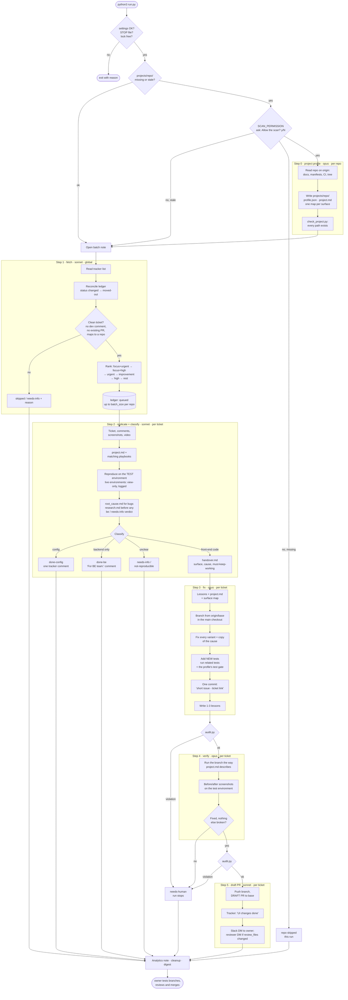
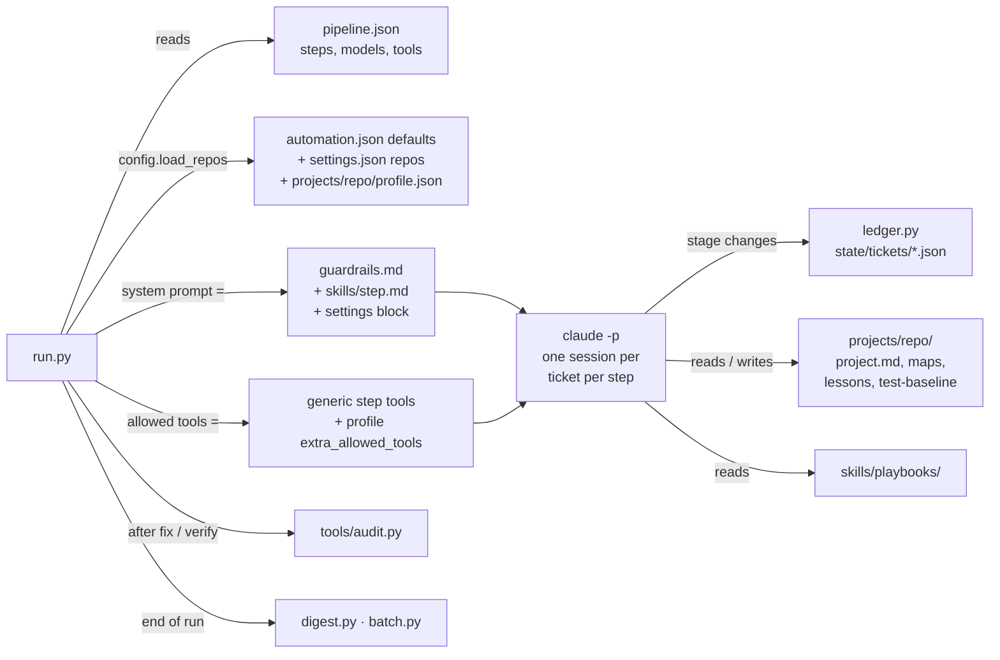
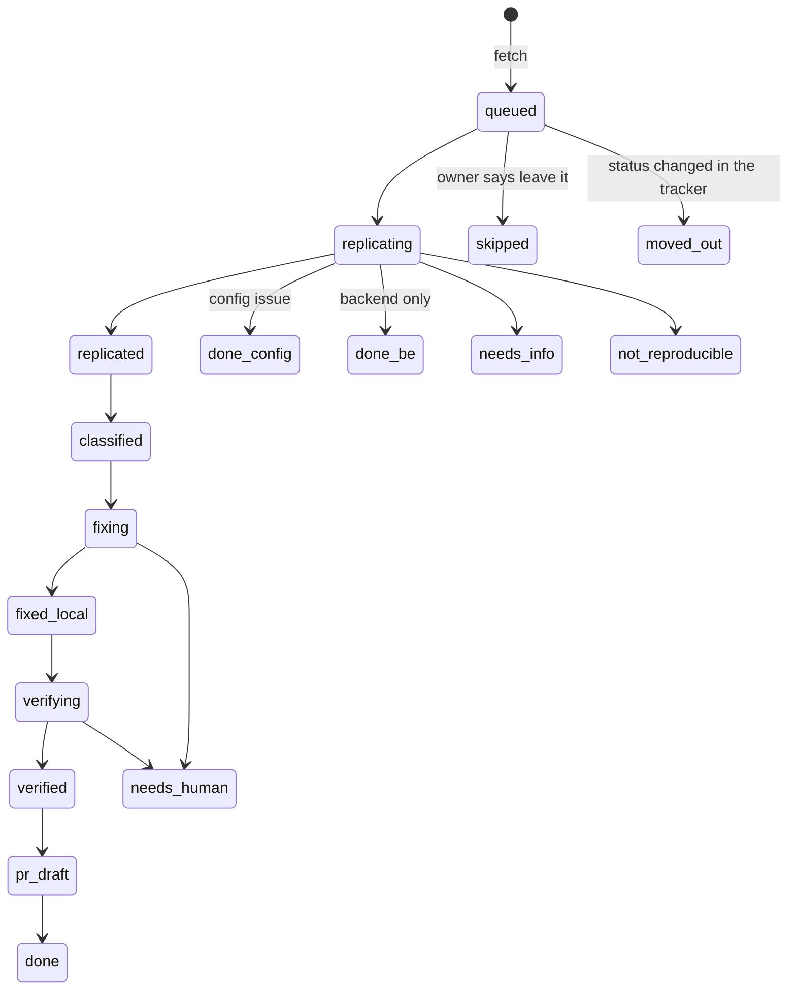
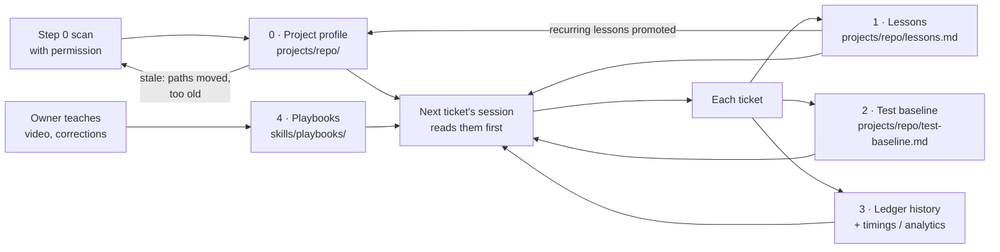

# Ticket automation

An unattended "front-end developer" built on Claude Code. It picks up tracker tickets, reproduces them, decides what kind of work they are, fixes the front-end ones on a local branch with new tests, checks the fix on your test environment, and opens a **draft** PR for a human to review and merge.

Nothing in this repository is about a particular project. The facts about each of your repos (surfaces, folders, commands, local-only files, how to run and verify it) are **generated on your machine**. Step 0 scans the repo, but only after you allow it, and the result stays out of git.

- [Quick setup](#quick-setup)
- [Full automation flow](#full-automation-flow)
- [Step 0: project profile and scan permission](#step-0-project-profile-and-scan-permission)
- [Ticket stages](#ticket-stages)
- [What it is made of](#what-it-is-made-of)
- [How it learns by itself](#how-it-learns-by-itself)
- [Safety model](#safety-model)
- [Folder layout](#folder-layout)
- Day-to-day commands: [OPERATIONS.md](OPERATIONS.md)

---

## Quick setup

**1. Requirements**

- Python 3.9 or newer (standard library only, nothing to `pip install`)
- [Claude Code](https://claude.com/claude-code) CLI (`claude`) with the **ClickUp** and **Slack** connectors (a support-desk connector is optional)
- GitHub CLI (`gh`), logged in, with push access to your repos
- Chrome with the Claude extension, for the browser steps (replicate and verify)
- Your repos cloned locally, each able to run its own dev server and tests

**2. Fill in your settings**

```bash
cp settings.example.json settings.json
```

`settings.json` is git-ignored. It holds only what the automation cannot find out by itself:

| Key | What to put |
|---|---|
| `OWNER_NAME`, `OWNER_EMAIL` | The developer the automation works for |
| `CLICKUP_TEAM_ID`, `CLICKUP_LIST_ID`, `CLICKUP_STATUS`, `CLICKUP_ASSIGNEE` | Where tickets are fetched from |
| `DEVELOPER_NAMES` | Optional. Other developers; a ticket they commented on is skipped as already taken |
| `GITHUB_OWNER` | GitHub org/user, used to find existing PRs for a ticket |
| `SLACK_DM_CHANNEL` | Your Slack DM channel id, for progress and failure messages |
| `REVIEWER_NAME`, `REVIEWER_SLACK_USER`, `REVIEWER_SLACK_CHANNEL` | Optional. Who gets a review DM when a repo's `review_files` change |
| `NOTES_FOLDER` | Apple Notes folder for batch notes |
| `SCAN_PERMISSION` | `ask` (default), `always` or `never`; see [Step 0](#step-0-project-profile-and-scan-permission) |
| `repos.<name>.path` | Absolute path of the repo checkout |
| `repos.<name>.ticket_match` | Title prefixes / tags that map a ticket to this repo |
| `repos.<name>.test_environment` | `url`, `host`, and `notes` (how to sign in, test accounts, passwords). The **only** place the automation may change anything. |
| `repos.<name>.focus_keywords`, `review_files`, `base_branch` | Optional |

Flat keys can also come from environment variables with the same name.

**3. Check**

```bash
python3 config.py check
```

**4. Run**

Dry run first (prints what would happen, changes nothing):

```bash
python3 run.py --dry-run
```

Then the real run. On the first run it asks to scan each repo, then works tickets:

```bash
python3 run.py
```

To stop at any time, create a `STOP` file in this folder:

```bash
touch STOP
```

All other commands are in [OPERATIONS.md](OPERATIONS.md).

---

## Full automation flow

Each step is its **own fresh `claude -p` session**: one ticket, one model, its own tool allow-list and timeout. Context never piles up between tickets. Only one session runs at a time, and the runner waits while the machine is busy.



How the code drives that flow:



---

## Step 0: project profile and scan permission

At the start of **every run**, each enabled repo's `projects/<repo>/` is checked:
- **missing**: the repo has never been scanned.
- **stale**: older than `profile_max_age_days` (14), a path in it no longer exists on origin, or many files changed since the scan.
- **ok**: used as it is.

When a scan is needed, step 0 asks first. The scan only reads the repo; nothing in it is changed.

```
Repo 'my-app' (/path/to/my-app): no project profile yet (first run).
Step 0 will READ this repo with Claude (docs, folder tree, package scripts, git history of origin) and write
.../projects/my-app/ (profile.json, project.md, one map per surface). Nothing in the repo is changed.
Allow the scan? [y/N]
```

- `SCAN_PERMISSION: "ask"` (default) asks in the terminal. Without a terminal (scheduled or remote runs) there is no scan; the run prints the command to do it yourself.
- `"always"` scans without asking; `"never"` doesn't scan.
- Refused for a stale profile: the old profile is used. Refused with no profile: the repo is skipped for that run.
- To rescan at any time (it still asks):

```bash
python3 run.py --map <repo>
```

What step 0 writes, all git-ignored:

| File | Contents |
|---|---|
| `profile.json` | Base branch, surfaces and their folders, backend / never-change paths, generated files, local-only files, existing-test pattern, commands (start, related tests, test gate, lint, typecheck, build), extra allowed tools for those commands, focus and surface keywords, guard action words, deploy notes |
| `project.md` | Stack, folder lock per surface, copies of the same rule, how to run and **verify** locally, tests, research map, live environments, PR notes |
| `<surface>.md` | One map per surface: where code lives, feature → file → twin table, deprecated folders, traps, tests |

The repo's own learned files sit beside them, `lessons.md` and `test-baseline.md` (see below). Commands are taken only from the repo's own manifests and CI; step 0 never invents one. Later steps run only those commands (`extra_allowed_tools`); anything broader, `sudo` or `rm` is refused.

---

## Ticket stages



---

## What it is made of

### Step skills (`skills/`)

| Skill | Step | Model | What it does |
|---|---|---|---|
| `project_map.md` | 0 | opus | Scans one repo (with permission) and writes its profile, project file and surface maps. |
| `fetch.md` | 1 | sonnet | Reads the tracker, reconciles the ledger, keeps only clean tickets, maps each to a repo, ranks, queues up to `batch_size` per repo. |
| `replicate_classify.md` | 2 | sonnet | Reproduces on the test environment (live environments view-only), finds surface and cause, decides code / config / backend / needs-info, writes `handover.md`. |
| `fix.md` | 3 | opus | Fixes on a local branch: every variant and copy, new tests, existing tests and the test gate pass, one commit, lessons. |
| `verify.md` | 4 | opus | Runs the branch the way `project.md` describes, before/after screenshots, must-keep-working matrix, readability review. |
| `pr.md` | 5 | sonnet | Pushes, opens a **draft** PR in a fixed format, groups tickets that share files, tracker line, Slack DMs. |

### Shared skills

| Skill | What it does |
|---|---|
| `guardrails.md` | Hard rules added to **every** step's prompt. They always win. |
| `research.md` | In-depth research. **Mandatory** before a `be`, `needs-info` or "not supported" verdict: search the feature under every name it could have and trace the data end to end. |
| `root_cause.md` | For bugs: the live-environment step log, the breaking point (file:line), why it broke now (git history → PR), hypotheses, a must-keep-working matrix, the fix boundary and the lock test. |
| `live-view-only.md` | Default whitelist of view-only clicks on any live environment. |
| `slack_dm.md` | Who gets a DM, when, templates, one per ticket. |

### Playbooks (`skills/playbooks/`): taught, local only

A playbook is a procedure you teach for one ticket type: "for X, check A, then B", or the exact allowed clicks on your product's live environment. Playbooks are about your projects, so only `INDEX.md` and `_template-playbook.md` are in git.

- Step 2 follows every playbook whose trigger matches the ticket.
- A playbook named somewhere but missing on this machine is skipped and noted.
- Without a `<repo>-live-allowed-actions.md` playbook, `live-view-only.md` applies, so a missing playbook never weakens live-environment safety.

### Tools

| File | What it does |
|---|---|
| `run.py` | Orchestrator: step 0 check and permission, lock, one session per ticket per step, audit, digest, cleanup |
| `config.py` | Settings + profiles: `check`, `show`, `profile <repo> [key]`, `install` |
| `ledger.py` | Ticket state: `board`, `show`, `set`, `next`, `recover`, `cleanup`, `timings`, `batch` |
| `tools/audit.py` | Guardrail audit after fix and verify (local-only files, existing tests, clean tree, optional cleanup check) |
| `tools/check_staged.sh` | Blocks commits of local-only files and changes to existing tests (patterns from the profile) |
| `tools/check_project.py` | Checks that every path in the generated project files still exists on origin |
| `tools/lessons.py` | The notebook (see below) |
| `tools/guard.js`, `replicate.sh`, `repro.spec.template.ts` | Playwright repro with a network guard: only the test environment may receive changes |
| `tools/digest.py`, `tools/batch.py` | End-of-run digest; Apple Notes batch and analytics notes |
| `tools/check_skill_split.py` | When you split a long prompt, checks no rule was lost against a saved baseline |
| `dashboard/` | `build.py` + `index.html`: live board of the ledger |

---

## How it learns by itself

The agent has no hidden state between runs. Everything it learns goes into plain files that the next session reads. All of it is **local and per project**, so a fresh install starts empty and learns your repos.



0. **Project profile** (`projects/<repo>/`). Step 0 writes it from the code and refreshes it when it goes stale (checked every run). A rescan keeps the "Rules that cost time before" and "Deprecated" lines, and recurring lessons are promoted into it.
1. **Lessons** (`projects/<repo>/lessons.md`). After every ticket, solved or not, step 3 adds 1–3 one-line lessons per surface. Before every fix it reads the lessons for that surface. Duplicates are dropped, each lesson is under 300 characters, each surface keeps at most 40, and anything that looks like a secret is refused. Lessons true for every project go to `memory/lessons.md` (`--repo general`).
2. **Test baseline** (`projects/<repo>/test-baseline.md`). A test that fails on origin too is recorded once and reported as "pre-existing" afterwards.
3. **Ledger history and analytics** (`state/`). Each stage change records time and a note (`NEEDED:`, `BLOCKER:`, `OPEN DECISION:`). The digest and analytics note show the slowest step and why, which tells you what to teach next.
4. **Playbooks** (`skills/playbooks/`). When you walk through a ticket type, it becomes a playbook with a trigger row in `INDEX.md`.

What keeps the knowledge honest:
- **Never deleted:** cleanup removes evidence, logs and caches only.
- **Checked:** `check_project.py` checks that the maps still match the code, and stale profiles trigger a rescan request.
- **Backups:** one `<file>.bak` per edited automation file.

---

## Safety model

- **Live environments are view-only.** The only place where anything may change is the repo's `test_environment` from `settings.json`. Everywhere else the agent may navigate, read, and open a modal then close it with X (`skills/live-view-only.md`), and it logs every step it takes there.
- **Network guard:** Playwright repros abort every state-changing request to any host that is not the test environment.
- **Front-end only.** Backend work becomes one "For BE team:" tracker comment. The profile's `backend_paths` and `never_change` are never edited.
- **The tracker is read-only**, apart from a few defined comments. The agent never changes a ticket's status.
- **Git:**
  - one local branch per ticket from origin/<base>, one commit;
  - local-only files are never committed, and existing tests are never changed (`check_staged.sh`);
  - the test gate must pass;
  - **draft** PRs only. A human merges.
- **Scans need permission** (step 0). A scan only reads the repo.
- **Commands are limited** to the step's generic tools plus the repo's own commands from the profile.
- **Audit:** `tools/audit.py` runs after every fix and verify. A violation sets the ticket to `needs-human` and stops the run.
- **Nothing personal or project-specific is committed:** `settings.json`, `projects/`, playbooks, `memory/`, `state/` and `evidence/` are all git-ignored.

---

## Folder layout

```
config.py                 settings + profiles (check / show / profile / install)
settings.example.json     template → copy to settings.json (git-ignored)
automation.json           generic defaults (batch size, ranking, retention, tracker placeholders)
run.py                    orchestrator
ledger.py                 ticket state
pipeline.json             steps, models, generic tools, timeouts
guardrails.md             hard rules for every step
skills/                   step prompts, shared skills, live-view-only.md
skills/playbooks/         INDEX + template in git; your playbooks local
projects/                 templates in git; projects/<repo>/ generated by step 0 + learned per repo (git-ignored)
memory/                   cross-project lessons (git-ignored)
tools/                    audit, check_staged, check_project, lessons, guard, digest, batch notes
dashboard/                live board
OPERATIONS.md             day-to-day commands and behaviour
state/ evidence/ logs/    run-time data (git-ignored, created on first run)
```

## Add a repo

1. In `settings.json`, add a block under `repos`: `path`, `ticket_match` and `test_environment`.
2. Run `python3 config.py check`.
3. Run `python3 run.py --map <name>`. It asks permission, then writes `projects/<name>/`. Read `project.md` once and correct anything wrong.
4. Run `python3 run.py --repo <name> --dry-run`, then a real run.
